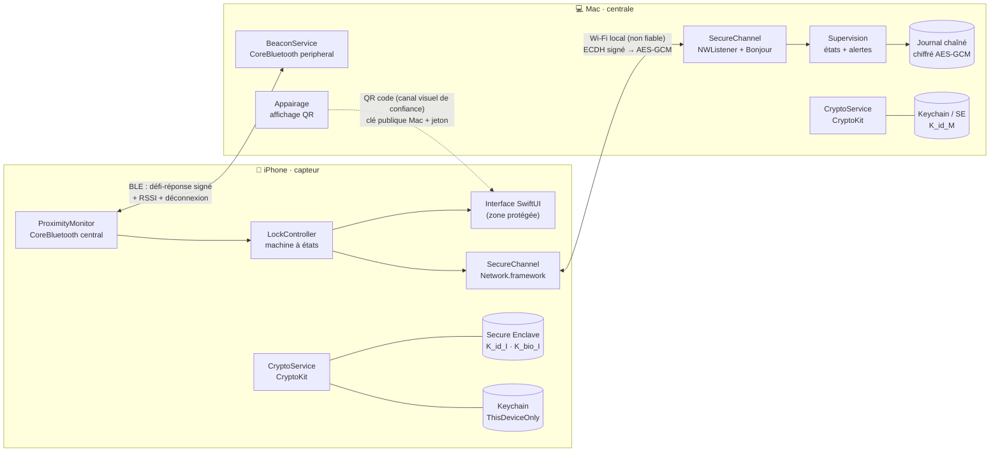
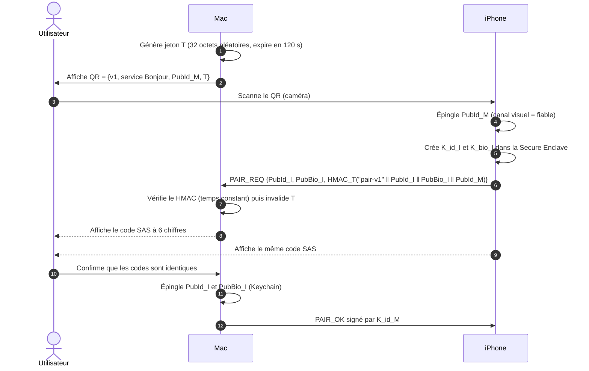
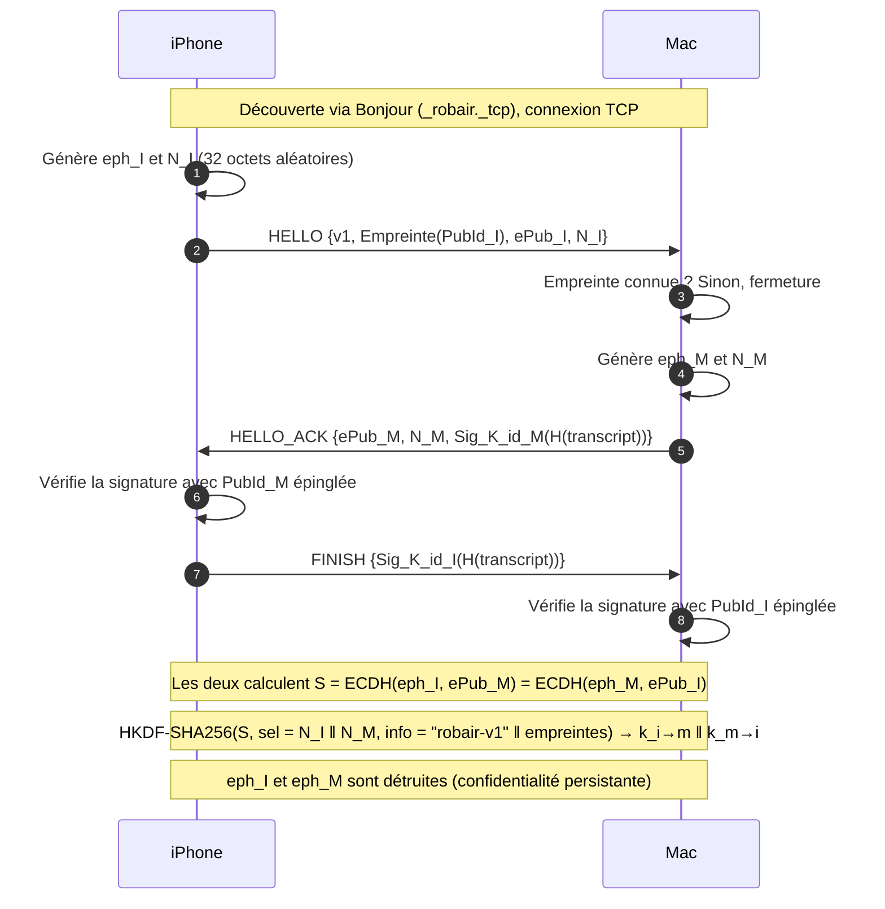
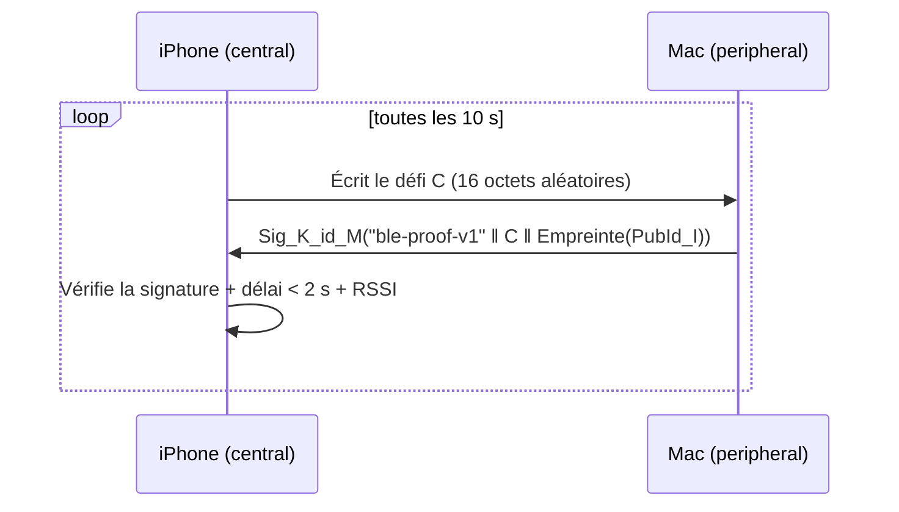
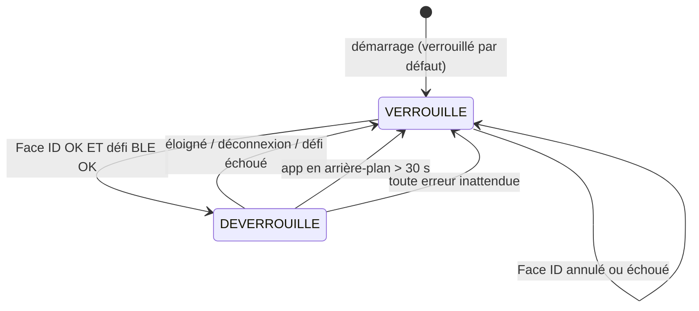

# J2 · Architecture et choix cryptographiques justifiés

> Livrable du jalon 2 : schéma iPhone ↔ Mac et choix crypto justifiés.
> Prérequis : [J1-cadrage.md](J1-cadrage.md). Les codes S1, T1, etc. renvoient au tableau STRIDE du J1.

---

## 1. Vue d'ensemble



**Trois canaux, trois niveaux de confiance :**

| Canal | Sert à | Confiance | Protection |
|---|---|---|---|
| **QR code** (écran du Mac → caméra de l'iPhone) | Appairage initial, une seule fois | ✅ Fiable : il faut être physiquement devant le Mac | Jeton à usage unique, expire en 2 min |
| **BLE** | Mesurer la proximité | ❌ Non fiable : clonable, brouillable | Défi-réponse signé, fail-safe |
| **Wi-Fi local** | États, alertes, journal | ❌ Non fiable : écoute, injection, faux Mac | Handshake ECDH signé, AES-GCM, anti-rejeu |

## 2. Les clés : qui possède quoi

| Clé | Type | Où | Protection d'accès | Sert à |
|---|---|---|---|---|
| **K_id_I** | P-256 signature | Secure Enclave de l'iPhone | `AfterFirstUnlockThisDeviceOnly`, sans Face ID | Signer le handshake de chaque session (fonctionne en arrière-plan) |
| **K_bio_I** | P-256 signature | Secure Enclave de l'iPhone | `WhenPasscodeSetThisDeviceOnly` + `biometryCurrentSet` | Signer les **actions sensibles** (déverrouillage, désarmement) : non-répudiation |
| **K_vault** | AES-256 symétrique | Keychain de l'iPhone | `WhenPasscodeSetThisDeviceOnly` + `biometryCurrentSet` | Chiffrer la zone protégée de l'app |
| **K_id_M** | P-256 signature | Secure Enclave du Mac (Apple Silicon ou T2), sinon Keychain | `ThisDeviceOnly` | Signer le handshake et les réponses aux défis BLE |
| **K_journal** | AES-256 + HMAC | Keychain du Mac | `ThisDeviceOnly` | Chiffrer et sceller le journal |
| **eph_I, eph_M** | P-256 accord de clés | **Mémoire uniquement**, détruites après le handshake | — | Confidentialité persistante |
| **k_i→m, k_m→i** | AES-256 | Mémoire, une paire par session | — | Chiffrer les messages, une clé par sens |
| **Jeton d'appairage** | 32 octets aléatoires | QR code + mémoire du Mac | Usage unique, 120 s | Prouver au Mac que l'iPhone a vu le QR code |

> **Pourquoi deux clés de signature sur l'iPhone ?** Votre J1 prévoyait de conditionner les signatures à Face ID. Mais l'iPhone doit pouvoir **signer en arrière-plan**, téléphone verrouillé dans la poche, pour établir une session et envoyer une alerte. On ne peut pas demander Face ID à chaque message.
> D'où K_id_I pour la routine (sans Face ID) et K_bio_I pour les actions sensibles (avec Face ID). Si un attaquant vole la session, il peut au pire envoyer de faux heartbeats. Il ne peut jamais produire un « déverrouillage signé ».

> **À vérifier au J3 :** l'accès à la Secure Enclave depuis une app macOS signée avec un compte gratuit. Si ça bloque, repli sur une clé P-256 logicielle dans le Keychain du Mac (`ThisDeviceOnly`). À documenter dans ce cas.

> **Contrainte de salle : un MacBook différent à chaque séance.** La clé K_id_M est liée au Mac qui l'a créée : elle ne sort pas de sa Secure Enclave ou de son Keychain. À chaque nouveau Mac, il faut donc **refaire l'appairage**, ce qui prend environ 30 s par QR code. C'est voulu : copier une clé privée d'identité d'une machine à l'autre irait contre le principe des clés non exportables.
> En fin de séance, il faut **effacer les clés et le journal du Mac prêté** (bouton « Réinitialiser la centrale »). Le journal étant chiffré, l'exporter n'a de sens que pour la démo.

## 3. Phase 1 : appairage par QR code (une seule fois par Mac)



**Explication pas à pas :**
- **Le QR code transporte la clé publique du Mac.** Comme on la lit physiquement sur l'écran, un attaquant réseau ne peut pas la remplacer. C'est ce qui empêche l'homme du milieu (slide 17 : « comparer une empreinte par QR code »).
- **Le jeton T prouve au Mac que la demande vient de l'iPhone qui a scanné.** L'attaquant réseau ne l'a jamais vu, donc il ne peut pas calculer le HMAC (S3).
- **Le code SAS** (*Short Authentication String*) est calculé comme `SHA-256(PubId_M ‖ PubId_I ‖ PubBio_I)` puis réduit à 6 chiffres. C'est une double vérification humaine, comme dans Signal ou l'appairage Bluetooth.
- **Usage unique et expiration** : une photo du QR code prise plus tard ne sert à rien.
- `HMAC.isValidAuthenticationCode` de CryptoKit compare **en temps constant**, ce qui évite une attaque par mesure du temps de réponse.

## 4. Phase 2 : ouverture d'une session chiffrée (à chaque connexion Wi-Fi)

C'est un **échange Diffie-Hellman éphémère signé**, le même principe que TLS 1.3 ou le protocole SIGMA.



- **transcript** = tous les champs échangés jusque-là, mis bout à bout. La signature couvre **tout** l'échange, donc un attaquant ne peut ni remplacer `ePub_M` par la sienne (S1), ni rejouer un ancien handshake (les nonces `N_I` et `N_M` sont neufs).
- Si une vérification échoue, la connexion est fermée et l'état devient `NON VÉRIFIÉ` (fail-safe).
- Délai maximal de 5 s pour l'ensemble du handshake (D2).

### Pourquoi signer les clés éphémères ?
Un échange ECDH « nu » est vulnérable à l'**homme du milieu**. L'attaquant fait un ECDH avec chacun des deux côtés et relaie. La signature par les clés d'identité épinglées lie les clés éphémères à des appareils connus.

### Pourquoi des clés éphémères en plus des clés d'identité ?
C'est la **confidentialité persistante** (slide 17). Si un jour la clé d'identité fuit, l'attaquant peut se faire passer pour l'appareil à l'avenir, mais il **ne peut pas déchiffrer les sessions passées** qu'il aurait enregistrées. Les clés de session venaient d'éphémères qui n'existent plus.

## 5. Phase 3 : messages chiffrés et anti-rejeu

### Format d'une trame

```
┌─────────────┬──────────┬──────────┬───────────────┬────────────────────────┬──────────┐
│ longueur u32│ version  │ type     │ compteur u64  │ données chiffrées      │ tag GCM  │
│ (≤ 4096)    │ 1 octet  │ 1 octet  │ big-endian    │ (JSON : état, ts, …)   │ 16 octets│
└─────────────┴──────────┴──────────┴───────────────┴────────────────────────┴──────────┘
              └──────── en-tête = AAD (authentifié, non chiffré) ──┘
```

- **AES-256-GCM** chiffre le contenu et produit un **tag d'authentification**. L'en-tête n'est pas chiffré, puisque le destinataire doit lire le compteur, mais il est **authentifié** comme AAD : le modifier fait échouer le tag (T1).
- **Nonce GCM (12 octets) = 4 octets à zéro ‖ compteur sur 8 octets.** Le compteur ne se répète jamais et il y a **une clé par sens**, donc le même couple (clé, nonce) n'est jamais réutilisé. C'est **la** règle vitale d'AES-GCM : réutiliser un nonce permet de récupérer des informations sur les messages et de forger des tags. C'est exactement le piège « IV fixe » de la slide 9.

### Les trois protections anti-rejeu (slide 17)
| Mécanisme | Ce qu'il bloque |
|---|---|
| **Compteur strictement croissant** par sens | Rejeu d'un message dans la même session : compteur ≤ dernier reçu, donc rejet et fermeture |
| **Clés de session neuves** à chaque handshake (nonces N_I et N_M) | Rejeu d'un message d'une ancienne session : il ne se déchiffre pas |
| **Horodatage** dans le contenu, fenêtre de ±60 s | Message retardé ou mis en attente par l'attaquant |

### Types de messages
| Type | Sens | Contenu | Signé par K_bio_I ? |
|---|---|---|---|
| `HEARTBEAT` | I → M | état courant, ts | non |
| `STATE` | I → M | `NEAR` / `AWAY` / `LOCKED`, ts | non |
| `ALERT_AWAY` | I → M | raison (RSSI, déconnexion, défi échoué), ts | non |
| `SENSITIVE_EVENT` | I → M | `UNLOCK` / `DISARM`, ts, **signature Face ID** | **oui** (R1) |
| `ACK` | M → I | compteur acquitté | non |

> **AES-GCM authentifie déjà, pourquoi une signature en plus pour les événements sensibles ?** AES-GCM prouve que le message vient de *quelqu'un qui a la clé de session*. Or le Mac a aussi cette clé : il pourrait fabriquer le message lui-même. Ce n'est donc **pas une preuve opposable**. Une signature ECDSA par K_bio_I ne peut venir **que** de l'iPhone, **après Face ID**. C'est la non-répudiation.

## 6. Détection de proximité (BLE)



- Le Mac annonce un **UUID de service générique** (sans nom ni donnée personnelle, I4).
- **Mode connecté** plutôt que simple écoute des annonces : iOS réveille l'app en arrière-plan en cas de déconnexion (mode `bluetooth-central`).
- Le défi inclut l'empreinte de l'iPhone. Une réponse obtenue pour un autre appareil ne sert donc à rien.
- **Pourquoi pas un iBeacon (Core Location) ?** Il faudrait la permission de **localisation**, ce qui va contre la minimisation RGPD et le moindre privilège. De plus, une annonce iBeacon se clone (S2).

### Règle « éloigné »
L'iPhone passe à `ÉLOIGNÉ` dès que **l'une** de ces conditions est vraie :
1. Déconnexion BLE.
2. Défi sans réponse valide sous 2 s, ou signature invalide.
3. RSSI moyen sur 5 mesures inférieur à −80 dBm (seuil à calibrer en démo). Le retour à `PROCHE` exige un RSSI supérieur à −70 dBm : cet écart (**hystérésis**) évite de clignoter entre les deux états.

## 7. Machine à états de l'iPhone (fail-safe)



- **Démarrage = verrouillé.** Il faut une preuve pour ouvrir, pas l'inverse (« échouer en sécurité », slide 15).
- Au verrouillage, la clé `K_vault` déchiffrée est **effacée de la mémoire** et l'interface protégée est masquée.
- **Côté Mac** : sans heartbeat valide depuis 30 s, ou en cas de perte BLE, l'état passe à `NON VÉRIFIÉ`. Le Mac ne suppose jamais que « tout va bien » par défaut.

## 8. Stockage et protection des données

| Donnée | Emplacement | Protection | Justification |
|---|---|---|---|
| Clés privées K_id_I, K_bio_I | Secure Enclave (le Keychain ne garde qu'un blob opaque) | Non exportables | Slide 16 : « des clés qui ne sortent jamais » |
| Clés publiques épinglées | Keychain | `ThisDeviceOnly` | Intégrité (A6), jamais dans les sauvegardes iCloud |
| Contenu de la zone protégée | Fichier | `FileProtectionType.complete` + chiffré par K_vault | Illisible téléphone verrouillé (I3) |
| États et compteurs de session | **Mémoire** uniquement | — | Rien à écrire en arrière-plan |
| Journal du Mac | Fichier | AES-GCM (K_journal) + chaîne de hachages + HMAC | T2, R2, slide 5 (« sauvegarde chiffrée ») |

> **Point corrigé par rapport au J1 :** la protection `Complete` rend un fichier illisible **dès que le téléphone est verrouillé**. Or l'app tourne en arrière-plan, téléphone verrouillé. On a donc séparé les données : le contenu protégé est en `Complete` (on n'en a besoin que lorsqu'il est ouvert) et tout ce dont l'arrière-plan a besoin reste en mémoire.

**Autres mesures (slide 19) :**
- **Aperçu multitâche** : un écran de masquage s'affiche quand `scenePhase` passe à `.inactive`.
- **Presse-papiers** : l'app n'y copie rien.
- **Logs** : `os.Logger` avec `privacy: .private` par défaut, jamais de clé, de jeton, de nonce ni de RSSI. Les `print()` sont interdits (règle de revue).

### Journal chaîné du Mac
```
entrée_n = { ts, type, appareil (empreinte), données, signature_bio?,
             h_prec = SHA-256(entrée_{n-1}) }
sceau    = HMAC-SHA256(K_journal, entrée_n)
```
Modifier ou supprimer une entrée change son hachage. L'entrée suivante ne correspond plus, et la rupture est détectable. Le HMAC empêche de recalculer toute la chaîne sans la clé.

## 9. Choix cryptographiques justifiés

Règle d'or (slide 16) : **ne jamais inventer sa propre cryptographie.** Nous n'utilisons que des primitives standard de CryptoKit, assemblées selon un schéma connu (handshake de type TLS 1.3 ou SIGMA).

| Besoin | Choix | Alternatives rejetées et pourquoi |
|---|---|---|
| Chiffrer les messages | **AES-256-GCM** (`AES.GCM`) | **AES-ECB** : les blocs identiques donnent des chiffrés identiques, des motifs fuient. **AES-CBC** seul : aucune intégrité, vulnérable au *padding oracle*. ChaCha20-Poly1305 serait aussi correct, mais AES est accéléré matériellement sur les puces Apple. |
| Signer | **ECDSA P-256** (`SecureEnclave.P256.Signing`) | Ed25519/Curve25519 est excellent mais **non supporté par la Secure Enclave**, qui ne gère que P-256. RSA : clés lourdes, pas de Secure Enclave. |
| Échanger les clés | **ECDH P-256 éphémère** (`P256.KeyAgreement`) | Clé partagée fixe : pas de confidentialité persistante. RSA (chiffrer la clé de session) : pas de confidentialité persistante non plus. |
| Dériver les clés de session | **HKDF-SHA256** | Utiliser directement le secret ECDH comme clé : il n'est pas uniformément aléatoire et il ne donnerait qu'une clé pour les deux sens. |
| Intégrité et sceau du journal, preuve d'appairage | **SHA-256 / HMAC-SHA256** | **MD5, SHA-1** : collisions connues, cassés. Hachage simple sans clé : n'importe qui peut le recalculer. |
| Aléa (nonces, défis, jetons) | **`SymmetricKey(size:)` / `SecRandomCopyBytes`** | `rand()`, `arc4random_uniform` sur une graine fixe, `Date()` : **aléa non cryptographique**, prévisible (slide 9). |
| Canal Wi-Fi | **Protocole maison sur TCP construit avec CryptoKit** | **TLS 1.3** avec certificats auto-signés épinglés serait la réponse industrielle. Le sujet demande explicitement de maîtriser ECDH, HKDF et AES-GCM, et ces primitives s'intègrent directement aux clés Secure Enclave. Notre handshake reproduit la structure de TLS 1.3. **Risque assumé :** un protocole assemblé à la main est plus fragile, d'où les tests d'attaque de la section 11. |
| Comparaison de secrets | **`isValidAuthenticationCode`** (temps constant) | `==` sur des `Data` : le temps de réponse révèle combien d'octets correspondent. |

## 10. Permissions demandées (moindre privilège)

| Plateforme | Clé `Info.plist` ou entitlement | Demandée quand | Pourquoi |
|---|---|---|---|
| iPhone | `NSBluetoothAlwaysUsageDescription` | Au premier armement | Proximité BLE |
| iPhone | `UIBackgroundModes : bluetooth-central` | — | Être réveillé à la déconnexion |
| iPhone | `NSCameraUsageDescription` | **Uniquement** à l'appairage | Lire le QR code |
| iPhone | `NSFaceIDUsageDescription` | Au premier déverrouillage | Actions sensibles |
| iPhone | `NSLocalNetworkUsageDescription` + `NSBonjourServices` (`_robair._tcp`) | À la connexion au Mac | Wi-Fi local |
| Mac | `NSBluetoothAlwaysUsageDescription`, `com.apple.security.device.bluetooth` | Au lancement | Balise BLE |
| Mac | `com.apple.security.network.server` | Au lancement | Recevoir les connexions |

**Non demandées :** localisation, micro, photos, contacts, notifications push.

## 11. Plan de tests et d'attaque (étapes 4 et 5 de la boucle)

| # | Test | Résultat attendu | Menace |
|---|---|---|---|
| 1 | Rejouer une trame capturée | Rejetée (compteur), connexion fermée | Rejeu |
| 2 | Modifier 1 bit du chiffré ou de l'en-tête | Échec du tag GCM, rejet | T1 |
| 3 | Trame tronquée, ou de 1 Mo | Rejet sans plantage | T3, D2 |
| 4 | Faux Mac avec une autre clé | Signature du handshake invalide, `NON VÉRIFIÉ` | S1 |
| 5 | Cloner l'annonce BLE (app nRF Connect sur un autre téléphone) | Défi sans signature valide, verrouillage | S2 |
| 6 | Réutiliser un QR code après 2 min ou après appairage | Refusé | S3 |
| 7 | Annuler Face ID | Reste `VERROUILLÉ` | E1 |
| 8 | Ajouter un visage dans Face ID après appairage | K_bio_I invalidée, réappairage nécessaire | E2 |
| 9 | Modifier une ligne du journal du Mac | Chaîne rompue, détectée au contrôle | T2 |
| 10 | Couper le Wi-Fi ou le Bluetooth | iPhone `VERROUILLÉ`, Mac `NON VÉRIFIÉ` | D1 |
| 11 | Tests unitaires : HKDF avec deux sens donne des clés différentes, le nonce ne se répète jamais, un compteur ≤ dernier est rejeté | OK | Crypto |
| 12 | Chercher dans les logs (Console.app) des clés, jetons ou RSSI | Aucun | I2 |

## 12. Découpage pour le J3 (MVP)

| Lot | Contenu | Rôle principal |
|---|---|---|
| L1 | Module `CryptoService` (handshake, HKDF, trames AES-GCM, compteurs) + tests unitaires. **Écrit en premier et partagé iPhone/Mac** (Swift package local) | Architecte sécurité + dev |
| L2 | Appairage : QR code (CoreImage côté Mac, AVFoundation côté iPhone), SAS, Keychain | Dev iOS |
| L3 | BLE : `BeaconService` (Mac) + `ProximityMonitor` (iPhone) + défi signé | Dev iOS |
| L4 | `LockController` + Face ID + zone protégée + masquage en arrière-plan | Dev iOS |
| L5 | App Mac : supervision + journal chaîné | Dev |
| L6 | Exécution du plan de tests (section 11) | Red team |

Ordre conseillé : **L1 → L2 → L3 → L4 → L5**, puis L6 en continu. L1 est le socle : tout le reste en dépend, et c'est le code le plus sensible à relire.
