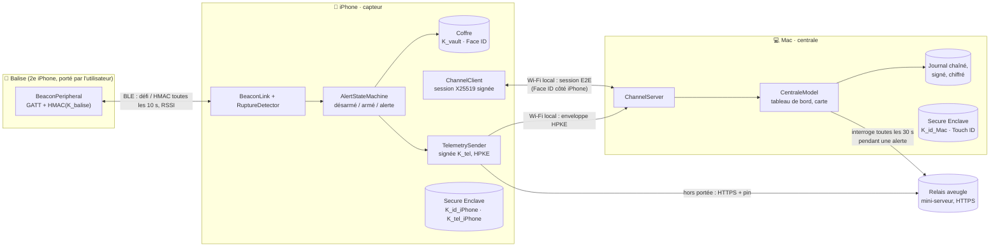
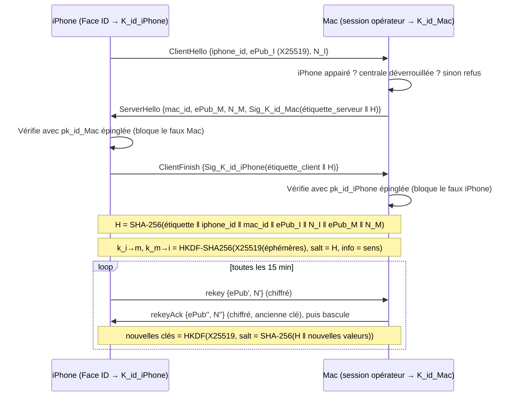
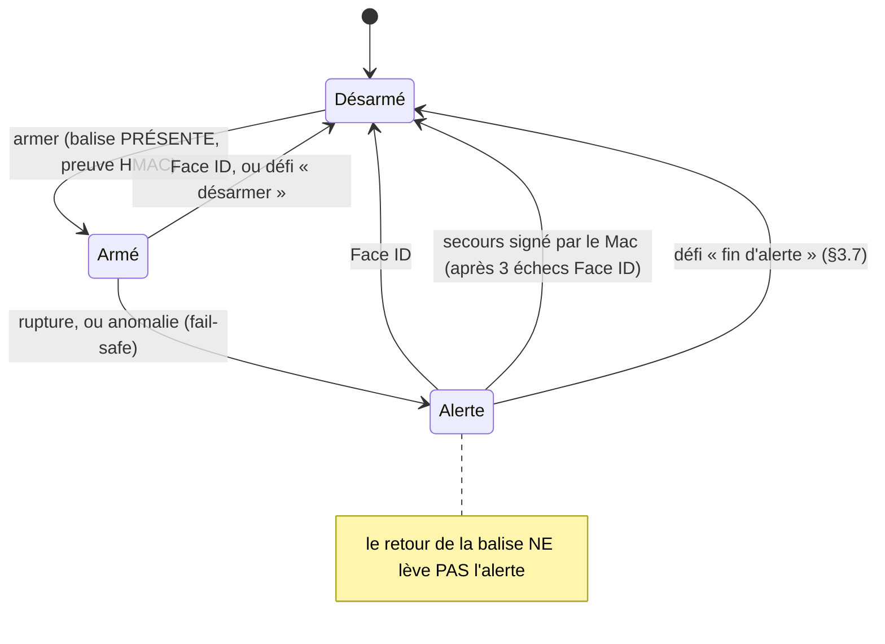
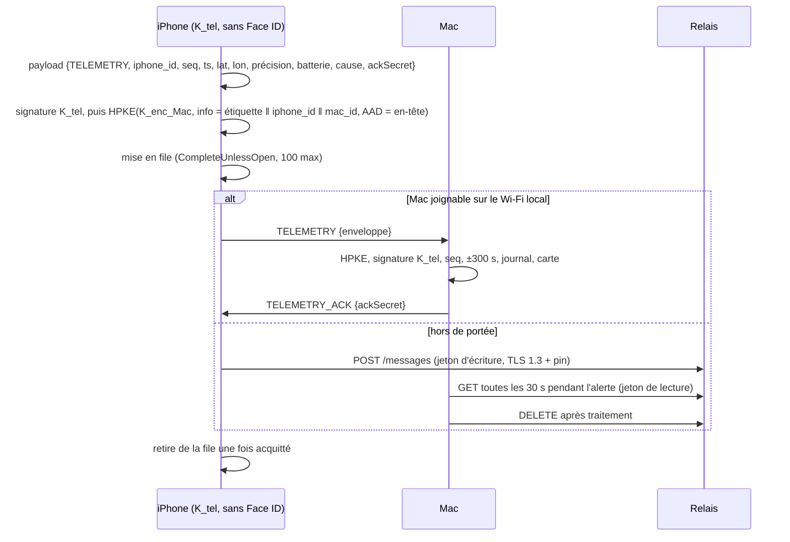

# J2 · Architecture et choix cryptographiques justifiés

> Livrable du jalon 2 (échéance proposée : lun. 30/11/2026) : schéma réseau, protocoles du J1 §3 formalisés, choix crypto justifiés, stack du relais.
> Prérequis : [J1-cadrage.md](J1-cadrage.md). Les renvois « §3.x » visent le J1, et les lignes S, T, R, I, D, E visent sa matrice STRIDE (§4).
> Le code correspondant est indiqué à chaque section. Toute la cryptographie est dans le package partagé `RobAirKit`.

---

## 1. Vue d'ensemble



| Canal | Sert à | Confiance | Protection |
|---|---|---|---|
| **QR code** | Appairage Mac ↔ capteur et balise ↔ capteur, secours | ✅ Visuel : il faut être devant l'écran | Jeton à usage unique (5 min), empreinte courte comparée par l'humain |
| **BLE** | Présence de la balise | ❌ Clonable, brouillable | Défi HMAC toutes les 10 s, rupture = alerte (fail-safe) |
| **Wi-Fi local** | Session, télémétrie, secours | ❌ Écoute, injection, faux Mac | Handshake signé, AES-GCM, HPKE, signatures, anti-rejeu |
| **Internet / relais** | Télémétrie hors de portée | ❌ Relais curieux ou compromis | TLS 1.3 + pinning **et** chiffrement de bout en bout |

## 2. Inventaire final des clés

| Clé | Type | Où | Protection | Usage | Code |
|---|---|---|---|---|---|
| **K_id_iPhone** | P-256 | Secure Enclave iPhone | `WhenUnlockedThisDeviceOnly` + `biometryCurrentSet` | Handshakes (§3.3), réponses aux défis du Mac (§3.7) | `DeviceIdentity` |
| **K_tel_iPhone** | P-256 | Secure Enclave iPhone | `AfterFirstUnlockThisDeviceOnly`, sans biométrie | **Télémétrie seulement** : le Mac la refuse pour toute autre action | `DeviceIdentity` |
| **K_vault** | AES-256 | Keychain iPhone | `WhenUnlockedThisDeviceOnly` + `biometryCurrentSet` | Coffre | `VaultStore` |
| **K_balise** | 256 bits (HMAC) | Keychain des deux iPhone | `AfterFirstUnlockThisDeviceOnly` | Preuve de présence de la balise (§3.9) | `BeaconKeyStore` |
| **K_id_Mac** | P-256 | Secure Enclave du Mac (repli : Keychain + Touch ID) | Touch ID / mot de passe (`userPresence`) | Handshakes, confirmation d'appairage, secours, signature de K_enc | `MacIdentity` |
| **K_enc_Mac** | X25519 | Keychain du Mac | Rotation hebdomadaire, clé publique **signée par K_id_Mac**, anciennes clés gardées 14 jours | Réception HPKE de la télémétrie | `EncryptionKeyring` |
| **K_journal** | P-256 + AES-256 | Keychain du Mac | `AfterFirstUnlockThisDeviceOnly` | Signer chaque entrée du journal et chiffrer le fichier | `JournalStore` |
| Éphémères de session | X25519 | Mémoire | Détruites après usage | Forward secrecy | `Handshake.swift` |
| Clés de session | AES-256 ×2 (une par sens) | Mémoire | Détruites à la fermeture, renouvelées toutes les 15 min | Messages de session | `Record.swift` |
| Jeton d'appairage | 32 octets | QR + mémoire du Mac | Usage unique, 5 min, 3 essais | Preuve « j'ai vu le QR » | `Pairing.swift` |
| Jetons du relais | 256 bits (écriture / lecture) | Keychain (iPhone : écriture ; Mac : lecture) | Stockés **hachés** sur le relais | Accès à la boîte aux lettres | `RelayAPI.swift` |

## 3. Écarts et précisions par rapport au J1

Relevés en formalisant les protocoles. **À valider en équipe** : chaque point peut être gardé, modifié ou rejeté, et la décision doit être reportée dans le journal IA.

| # | Point du J1 | Problème relevé | Décision proposée (implémentée) |
|---|---|---|---|
| 1 | §3.3 : handshake signé par **K_id_iPhone (Face ID)**, renégocié toutes les 15 min | Face ID impossible en arrière-plan, et un Face ID toutes les 15 min serait pénible | La **session n'est ouverte qu'au premier plan** (un Face ID). Le **renouvellement des 15 min se fait dans la session** : nouvel échange X25519 authentifié par la session en cours, sans nouvelle signature, et donc sans Face ID. La forward secrecy est conservée. **La télémétrie et le secours n'ont pas besoin de session** : ils sont protégés par HPKE et des signatures. |
| 2 | §2.2 : **Touch ID à chaque signature** de K_id_Mac | Chaque reconnexion de l'iPhone exigerait un opérateur au clavier | **« Session opérateur »** : un Touch ID rend la centrale disponible 30 min pour les handshakes. Hors de cette fenêtre, les sessions sont **refusées** (fail-safe, entrée au journal). Les signatures rares et sensibles (confirmation d'appairage, secours, rotation de K_enc) **redemandent toujours** Touch ID. |
| 3 | §3.5 : « une fois acquitté, supprimé de la file » | Un accusé non authentifié permettrait à un attaquant réseau de faire vider la file de l'iPhone | Le contenu chiffré porte un **`ackSecret`** aléatoire. Le Mac le renvoie pour prouver la réception : seul lui a pu le déchiffrer. |
| 4 | §3.4 : fenêtre de 30 s, 300 s pour la télémétrie différée | Le Mac ne peut pas savoir si une télémétrie reçue en local sort de la file d'attente | La **fenêtre de 300 s s'applique à toute la télémétrie**. Le rejeu reste bloqué par `seq`. ⚠️ **Question ouverte :** une position restée plus de 5 min en file (relais injoignable) sera refusée. Faut-il élargir la fenêtre à 72 h, la durée de vie du relais, et ne garder que `seq` contre le rejeu ? |
| 5 | §3.9 : `HMAC(K_balise, défi)` | Pas de séparation de domaine | `HMAC(K_balise, "robair-beacon-proof-v1" ‖ défi)`. C'est la même idée, avec un usage explicite. |
| 6 | §3.3 : ECDH X25519 | Une clé X25519 « de faible ordre » donne un secret partagé **nul**, que la bibliothèque **n'a pas refusé** | Vérification explicite (RFC 7748 §6.1). **Bug trouvé par le test** `testLowOrderEphemeralIsRejected`. |
| 7 | §4 T : « journal chaîné par hash et entrées signées » | Une chaîne seule ne détecte pas la suppression des **dernières** entrées | Signature ECDSA (K_journal) de chaque entrée, plus une **ancre** (nombre d'entrées et dernier hash) gardée à part dans le Keychain. |
| 8 | §1.3 : localisation en continu et `location` en arrière-plan | « Toujours » est une permission large ; démarrer le GPS en arrière-plan l'exige normalement | Autorisation **« Lors de l'utilisation »** seulement. Une `CLBackgroundActivitySession` (iOS 17) est ouverte **à l'armement**, ce qui permet de démarrer le GPS en arrière-plan si une alerte survient. iOS affiche l'indicateur bleu tant que la surveillance est armée : c'est transparent pour l'utilisateur. |
| 9 | §3.8 : défi de secours envoyé par le réseau | N'importe qui sur le Wi-Fi peut envoyer une fausse demande au Mac | Un **code à 6 chiffres** (hash du défi) est affiché sur l'iPhone et sur le Mac. L'opérateur ne signe que s'il voit l'iPhone et le même code. Trois demandes par minute au plus. |
| 10 | §3.4 : « tout champ inconnu fait rejeter le message » | `JSONDecoder` ignore les champs inconnus par défaut | Décodeur strict `StrictJSON` : il compare récursivement les clés JSON aux propriétés déclarées. |
| 11 | §3.6 : pinning de la clé publique | Let's Encrypt change de clé au renouvellement | Pin = SHA-256 de la clé publique ECDSA P-256. Le certificat est émis avec `certbot --reuse-key`, et le pin est calculé par `relay/tools/pin.sh`. Un test vérifie que serveur et iOS calculent le même pin. |
| 12 | §2.3 : stack du relais « à trancher au J2 » | — | **Python 3, bibliothèque standard uniquement** : zéro dépendance tierce (voir §11 et [relay/README.md](../relay/README.md)). |
| 13 | Mac « balise » (ancienne architecture) | La balise est désormais le 2e iPhone | Le Mac n'utilise plus le Bluetooth : l'entitlement a été retiré (moindre privilège). |
| 14 | État après redémarrage | Si iOS tue l'app en alerte, l'alerte ne doit pas disparaître | L'état armé ou en alerte est **persisté** dans le Keychain. Un chien de garde passe en alerte si l'app est armée mais que la balise n'est pas confirmée dans les 20 s. |

### 3.1 Écart « relais » (J1 §1.4) : validé par l'architecte

**Validé côté équipe** par l'architecte sécurité (Samuel Dorismond) le 23/11/2026, en extension P2, aux conditions suivantes :
- le socle sur le Wi-Fi local (P0, P1) fonctionne **sans** le relais ; on coupe le relais avant de toucher au socle ;
- le relais ne reçoit que de la télémétrie **signée puis chiffrée en HPKE** (§8) : il ne peut ni la lire ni la fabriquer ;
- TLS 1.3 avec pinning (écart 11), jetons distincts et hachés, aucun journal de contenu ni d'IP (§11) ;
- les menaces du relais restent couvertes par la STRIDE (J1 §4) et l'audit MASVS (J1 §5).

L'accord de l'encadrant reste nécessaire (J1 §1.4). S'il refuse, on applique le repli : file locale chiffrée, renvoyée quand le Mac redevient joignable.

## 4. Appairages (§3.2 et §3.9)

### 4.1 Capteur ↔ Mac

```mermaid
sequenceDiagram
    autonumber
    actor U as Opérateur
    participant M as Mac
    participant I as iPhone capteur
    U->>M: Touch ID (session opérateur ; crée K_enc si besoin)
    M->>U: QR = {v, mac_id, nom Bonjour, pk_id_Mac, K_enc signée, relais (URL + pin), jeton T (5 min)}
    U->>I: Scanne le QR
    I->>I: Vérifie : K_enc signée par pk_id_Mac du QR, expiration, format strict
    I->>I: Crée K_id_iPhone (Face ID) et K_tel_iPhone dans la Secure Enclave
    I->>M: PAIR_REQ {pk_id, pk_tel, HMAC_T(étiquette ‖ pk_id ‖ pk_tel ‖ pk_id_Mac ‖ pk_enc)}
    M->>M: HMAC en temps constant, jeton consommé (3 essais max)
    M-->>U: Empreinte courte (6 chiffres sur TOUTES les clés publiques)
    I-->>U: Même empreinte
    U->>M: « Identiques » + Touch ID frais
    M->>I: PAIR_RESULT signé par K_id_Mac
    Note over M,I: À la 1re session : le Mac crée la boîte sur le relais et envoie le jeton d'ÉCRITURE (canal chiffré). Il garde le jeton de lecture.
```

### 4.2 Capteur ↔ balise

La balise tire au hasard **K_balise** (32 octets) et un **UUID de service**, puis les affiche en QR code, à la demande et pendant 60 s au plus. Le capteur scanne ce QR. Le QR contient un secret : il ne faut le montrer qu'au capteur. « Générer une nouvelle clé » invalide l'ancien appairage.

## 5. Session locale (§3.3) · `Handshake.swift`



- Les **étiquettes client et serveur sont différentes** : une signature ne peut pas être renvoyée « en miroir ».
- La signature couvre **toute** la transcription : remplacer une clé éphémère (homme du milieu) casse la vérification.
- **Forward secrecy :** les éphémères sont détruites. Une clé d'identité volée plus tard ne déchiffre pas les sessions passées.
- **Nouvelle négociation** à chaque reconnexion et après chaque levée de verrouillage, avec le Face ID qui vient d'être fait.

## 6. Enveloppe et règles de réception (§3.4) · `Record.swift`, `Wire.swift`

```
[longueur u32][version u8][type u8][sender_id 16][seq u64][timestamp ms u64] [chiffré] [tag 16]
              └──────────────── en-tête = AAD (authentifié, non chiffré) ──┘
nonce AES-GCM = préfixe de sens (4 octets) ‖ seq (8 octets)
```

- **Nonce jamais réutilisé :** `seq` strictement croissant, une clé par sens et un préfixe de sens.
- **Anti-rejeu :** refus si `seq ≤ dernier accepté` ou si l'horodatage s'écarte de plus de ±30 s. Le dernier `seq` n'avance **qu'après** un déchiffrement réussi. Sinon, une trame forgée avec un `seq` énorme bloquerait la session.
- **Validation stricte :** 4 Ko maximum, rejetés *avant* allocation ; type attendu à chaque étape ; un type chiffré n'est jamais accepté en clair ; décodage strict (champ inconnu = rejet) ; bornes vérifiées.
- **Erreur = rejet silencieux + entrée au journal.** Aucun détail n'est renvoyé à l'émetteur.

## 7. Détection de rupture et machine à états (§3.9) · `Beacon.swift`, `AlertState.swift`

**Rupture** dès que l'une de ces conditions est vraie :
1. déconnexion BLE ;
2. réponse HMAC invalide ou absente sous 2 s, ou aucune preuve valide depuis 15 s ;
3. RSSI moyen sur 5 s sous **−85 dBm** pendant **plus de 3 s**. Pour sortir de cet état, il faut remonter au-dessus de **−75 dBm** (hystérésis).



**Entrée en alerte (§3.5, étape 1) :** le coffre est fermé et effacé de la mémoire (`SecureWipe` : `memset_s`, effacement au mieux), la session est détruite, l'alarme sonne et une notification locale s'affiche. **La première alerte part immédiatement**, avant même la première position GPS.

## 8. Télémétrie (§3.5) · `Telemetry.swift`, `TelemetrySender.swift`



- **HPKE** (RFC 9180, `HPKE.Ciphersuite(kem: .Curve25519_HKDF_SHA256, kdf: .HKDF_SHA256, aead: .AES_GCM_256)`) chiffre **sans session ouverte**. C'est ce qui permet la télémétrie en arrière-plan et via le relais.
- **Signer puis chiffrer :** le relais ne peut ni lire, ni fabriquer. Quelqu'un qui connaît la clé HPKE publique du Mac peut chiffrer, mais sans K_tel sa télémétrie est refusée (test `testForgedTelemetryIsRejected`).
- **Forward secrecy de la télémétrie :** elle est limitée à la période de rotation de K_enc_Mac (une semaine). C'est le compromis accepté au J1.

## 9. Défis et secours (§3.7, §3.8) · `Challenges.swift`

| | Défi Mac → iPhone (§3.7) | Déverrouillage de secours (§3.8) |
|---|---|---|
| Qui émet le défi | Le Mac (32 octets, 30 s) | L'iPhone (32 octets, 120 s) |
| Qui signe | iPhone, **K_id_iPhone après Face ID** | Mac, **K_id_Mac après Touch ID** |
| Message signé | étiquette ‖ défi ‖ mac_id ‖ iphone_id ‖ action | étiquette ‖ `EMERGENCY_UNLOCK` ‖ défi ‖ iphone_id ‖ horodatage |
| Transport | Session chiffrée | Réseau local **sans session**, ou QR code dans les deux sens (webcam du Mac) |
| Anti-rejeu | Défi consommé dès la 1re présentation, même fausse | Défi consommé, ordre lié au défi en attente |
| Effet | Fin d'alerte ou désarmement, journalisés **avec la signature comme preuve** | Lève le verrouillage **de RobAir** (pas d'iOS). Le coffre exige toujours Face ID. |

## 10. Journal d'audit · `EventJournal.swift`

```
entrée_n = {index, ts, type, appareil (pseudonyme), détail, preuve?, h_prec = SHA-256(entrée_{n-1})}
signature_n = ECDSA(K_journal, étiquette ‖ entrée_n)
fichier = AES-GCM(K_journal_enc, JSON)      ancre (Keychain) = {nombre d'entrées, dernier hash}
```

Modifier, supprimer, réordonner ou tronquer le journal est détecté (5 tests). La « preuve » jointe (signature Face ID d'une réponse à un défi, signature du secours) rend les actions **non répudiables**.

## 11. Relais aveugle (extension P2) · `relay/`

Python 3, bibliothèque standard uniquement. Les jetons sont distincts et hachés, les messages font 4 Ko au plus, 100 par boîte, pour une durée de vie de 72 h et 60 requêtes/min. Aucun journal de contenu ni d'IP. Le serveur exige TLS 1.3 et tourne dans un service systemd confiné, derrière un pare-feu qui n'ouvre que le 443. Détails, API et déploiement : [relay/README.md](../relay/README.md).

## 12. Choix cryptographiques justifiés

Règle d'or (slide 16) : **ne jamais inventer sa propre cryptographie.** Nous n'utilisons que des primitives standard de CryptoKit, assemblées selon des schémas connus (TLS 1.3 / SIGMA pour le handshake, RFC 9180 pour HPKE).

| Besoin | Choix | Alternatives rejetées |
|---|---|---|
| Signature | **ECDSA P-256** | Ed25519 : non supporté par la Secure Enclave, qui ne fait que du P-256. RSA : lourd, absent de la Secure Enclave. |
| Échange de clés de session | **X25519 éphémère** | Clé partagée fixe : pas de forward secrecy. P-256 ECDH : correct aussi, mais X25519 est celui choisi au J1, plus simple et résistant aux erreurs de validation. |
| Chiffrement de session | **AES-256-GCM**, une clé par sens | ECB : fuite de motifs. CBC seul : aucune intégrité, *padding oracle*. ChaCha20-Poly1305 : correct, mais AES est accéléré sur les puces Apple. |
| Chiffrement « hors session » | **HPKE** (RFC 9180) | Chiffrement maison ECDH + AES : risque d'erreur d'assemblage. HPKE est standard et intégré à CryptoKit depuis iOS 17. |
| Dérivation | **HKDF-SHA256** | Secret ECDH utilisé directement : pas uniforme, et une seule clé pour deux sens. |
| Intégrité, balise, appairage | **HMAC-SHA256** | MD5 et SHA-1 : cassés. Hash sans clé : n'importe qui peut le recalculer. |
| Aléa | **`SymmetricKey(size:)`** (générateur du système) | `random()`, horloge : prévisibles (slide 9). |
| Comparaison de secrets | **`isValidAuthenticationCode`** (temps constant) | `==` : le temps de réponse fuit l'information. |

## 13. Permissions (moindre privilège)

| Plateforme | Permission | Demandée quand | Pourquoi |
|---|---|---|---|
| iPhone | Bluetooth | Au lancement du mode choisi | Balise / surveillance |
| iPhone | Caméra | Au premier scan | QR codes (aucune image conservée) |
| iPhone | Localisation « Lors de l'utilisation » | **À l'armement** | Positions **en alerte seulement** |
| iPhone | Notifications locales | À l'armement | Alarme écran verrouillé |
| iPhone | Face ID | Première action sensible | Coffre, session, défis, levée d'alerte |
| iPhone | Réseau local + Bonjour `_robair._tcp` | Première connexion | Canal avec le Mac |
| iPhone | Modes d'arrière-plan `bluetooth-central`, `bluetooth-peripheral`, `location` | — | Réveil sur déconnexion, balise, envoi en alerte |
| Mac | Sandbox + réseau serveur et client + caméra | Au lancement / au scan | Centrale, relais, QR de secours |

**Non demandées :** localisation « Toujours », micro, photos, contacts, push, iCloud. Le Mac n'utilise **plus** le Bluetooth.

## 14. Tests

### Automatisés (exécutés)
- **`RobAirKit` : 103 tests** (`cd RobAirKit && swift test`). Ils couvrent : handshake (faux Mac, faux iPhone, miroir, altération, clé de faible ordre, renouvellement), enveloppes (rejeu, retard de plus de 30 s, chaque bit modifié, sens croisés, `seq` forgé), décodage strict (champ inconnu, même imbriqué), appairage (jeton faux, réutilisé, expiré, 3 essais, empreinte, QR dont la K_enc n'est pas signée par la bonne clé), télémétrie (forgée, altérée, mauvaise clé, bornes, doublons, horodatage), défis et secours (rejeu, expiration, action échangée, autre Mac, faux Mac), balise (clone, rejeu), rupture (hystérésis, 3 s), machine à états, journal (modifié, supprimé, tronqué, reforgé).
- **Relais : 15 tests** (`cd relay && python3 -m unittest`).

> Les 103 tests ont été exécutés sous Linux avec `swift-crypto`, le portage officiel de CryptoKit (même API), dans un dossier temporaire hors du dépôt. **À relancer sur Mac avec CryptoKit avant le J3.**

### Manuels, sur appareils (plan de la red team au J3)

| # | Test | Attendu | STRIDE |
|---|---|---|---|
| 1 | Cloner l'UUID de la balise (nRF Connect sur un autre téléphone) | Preuve HMAC invalide → alerte | S |
| 2 | S'éloigner avec le capteur armé | Alerte, coffre fermé, télémétrie sur le Mac | — |
| 3 | Couper le Bluetooth de la balise | Alerte immédiate | D |
| 4 | Faux Mac (autre Mac avec RobAir) | Handshake refusé | S |
| 5 | Rejouer une trame capturée (Wireshark) | Rejetée, entrée au journal | T, rejeu |
| 6 | Couper le Wi-Fi pendant l'alerte | Télémétrie via le relais, ou en file puis envoyée au retour | D |
| 7 | Rejouer un ordre de secours capturé | Refusé | S, rejeu |
| 8 | Ajouter un visage dans Face ID | K_id_iPhone et K_vault invalidées, réappairage | E |
| 9 | Modifier `journal.bin`, ou supprimer les dernières entrées | Rupture ou troncature détectée | T |
| 10 | Chercher positions, clés ou jetons dans Console.app | Rien | I |
| 11 | Copier du texte du coffre | Pas de presse-papiers universel, expiration à 60 s | I |
| 12 | Tuer l'app en alerte puis la relancer | Toujours en alerte | E |

## 15. Limites et risques résiduels

| Risque | Atténuation |
|---|---|
| **Relais BLE** (un complice retransmet la radio) | Non détectable sans mesure du temps de vol. Délai de réponse court, seuil RSSI. |
| **Arrière-plan iOS** : minuteries suspendues, donc pas de défi HMAC ni de RSSI | En arrière-plan, la détection repose sur la **déconnexion** (J1 §10). Au premier plan, la détection est complète. |
| Téléphone éteint ou en mode avion par le voleur | La première alerte part dès la rupture (J1 §1.3). |
| Effacement mémoire impossible à garantir en Swift | Effacement au mieux. La vraie protection est la Secure Enclave plus Face ID. |
| Relais saturé (`http.server`) | Extension de secours, le socle n'en dépend pas. La confidentialité n'est jamais touchée. |
| Mac sans session opérateur | Sessions refusées (fail-safe). La télémétrie et le secours fonctionnent quand même. |
| Accès Secure Enclave sur Mac avec un compte gratuit | Repli logiciel protégé par Touch ID. L'interface indique lequel est utilisé. **À vérifier au J3.** |
